# GPU Inference Benchmark

How much do serving choices change LLM inference speed on a single GPU? This
repo measures latency, throughput and GPU memory for Hugging Face `generate()`
and vLLM on one NVIDIA T4, across batch sizes and 1 to 64 concurrent users.
Every reported number comes from a CSV under `results/` and one command
reproduces it.

> **Status:** the baseline measurements below are complete. Of the
> optimization experiments, E4 (CUDA graphs against eager), E3 (prefix
> caching) and E1 (scheduler limits) are measured; E2 is set up but not yet
> run. See
> [Optimization experiments](#optimization-experiments) for the plan and its
> checkpoints.

## Findings

Measured on one Tesla T4 with vLLM 0.31.0 and transformers 5.17.0. Each figure
is the mean of 3 repeats; the largest spread (standard deviation ÷ mean) in any
setting was 2.3%.

- **vLLM was 2.8× to 5.1× faster than Hugging Face `generate()` at the same
  batch size** on Qwen2.5-0.5B with short prompts: 3,755 against 1,275
  tokens/s at batch 64, and 168 against 33 at batch 1. With 1,024-token
  prompts the gap was 3.1× to 4.5×.
- **The gap narrowed on the larger model:** 1.9× to 2.3× on Qwen2.5-1.5B
  (1,458 against 621 tokens/s at batch 64).
- **Batching was the bigger lever.** Hugging Face went from 33 to 1,275
  tokens/s between batch 1 and batch 64 on short prompts, a 38× gain. With
  long prompts it stopped paying after batch 8: 206 tokens/s at batch 8 and 267
  at batch 64, while peak memory rose from 2.9 GB to 12.1 GB.
- **Under concurrent load, vLLM's server traded latency for throughput.** From
  1 to 64 users, throughput rose 22× (165 to 3,629 tokens/s, within 4% of the
  offline batch-64 figure) while p95 end-to-end latency rose 2.9× (784 to
  2,291 ms). The wait for the first token grew far more than the gap between
  tokens: p95 time to first token went from 23 to 517 ms, inter-token latency
  from 5.9 to 15.0 ms.

- **Compilation explains the small-batch gap** (optimization experiment E4).
  With `torch.compile` and CUDA graphs turned off, vLLM ran at 40 tokens/s at
  batch 1, 1.2× Hugging Face instead of 4.8×. With a static KV cache and
  `torch.compile`, Hugging Face `generate()` reached 120 tokens/s, 3.5× its
  own baseline and 73% of vLLM. Details are under
  [E4](#e4-cuda-graphs-against-eager).

- **Prefix caching cut the wait for the first token at a fixed request rate**
  (optimization experiment E3). With prompts sharing half their 1,024 tokens,
  median time to first token fell 26% at 2 requests/s and 56% at 6. With a
  fixed number of users the gain showed up as 20% to 30% more throughput
  instead. Details are under [E3](#e3-prefix-caching).

- **Limiting concurrent sequences made tail latency worse, not better**
  (optimization experiment E1). At 64 users, capping the running batch at 16
  sequences halved throughput and doubled p95 end-to-end latency; vLLM's
  default scheduler limits were the best setting measured on both. Details
  are under [E1](#e1-scheduler-limits).

One measured clue to the small-batch gap: at batch 1 on the 0.5B model, Hugging
Face kept the GPU 38% busy and vLLM kept it 99% busy (`mean_util_pct` in the
CSVs). Hugging Face was waiting on work outside the GPU between tokens, which
is also why its throughput scaled almost linearly with batch size until the
GPU filled up.

## Results

Both tables are printed by `python -m analysis.summarize`. Throughput is mean ±
standard deviation over 3 repeats.

### Offline: Hugging Face against vLLM

| Model | Tokens in / out | Batch | HF tok/s | vLLM tok/s | vLLM ÷ HF | HF p95 latency (ms) | vLLM p95 latency (ms) | HF peak memory (GB) | vLLM peak memory (GB) |
| --- | --- | ---: | ---: | ---: | ---: | ---: | ---: | ---: | ---: |
| Qwen2.5-0.5B-Instruct | 128 / 128 | 1 | 33 ± 0 | 168 ± 4 | 5.1× | 3,906 | 773 | 1.6 | 13.5 |
| Qwen2.5-0.5B-Instruct | 128 / 128 | 8 | 258 ± 1 | 1,130 ± 2 | 4.4× | 3,993 | 910 | 1.6 | 13.5 |
| Qwen2.5-0.5B-Instruct | 128 / 128 | 32 | 958 ± 2 | 2,724 ± 1 | 2.8× | 4,293 | 1,508 | 1.9 | 13.6 |
| Qwen2.5-0.5B-Instruct | 128 / 128 | 64 | 1,275 ± 4 | 3,755 ± 6 | 2.9× | 6,427 | 2,181 | 2.1 | 13.9 |
| Qwen2.5-0.5B-Instruct | 1,024 / 256 | 1 | 32 ± 0 | 145 ± 0 | 4.5× | 8,059 | 1,783 | 1.7 | 13.5 |
| Qwen2.5-0.5B-Instruct | 1,024 / 256 | 8 | 206 ± 0 | 637 ± 0 | 3.1× | 9,951 | 3,220 | 2.9 | 13.9 |
| Qwen2.5-0.5B-Instruct | 1,024 / 256 | 32 | 256 ± 0 | 964 ± 1 | 3.8× | 31,979 | 8,507 | 6.8 | 14.0 |
| Qwen2.5-0.5B-Instruct | 1,024 / 256 | 64 | 267 ± 0 | 1,052 ± 3 | 3.9× | 61,370 | 15,575 | 12.1 | 14.0 |
| Qwen2.5-1.5B-Instruct | 128 / 128 | 1 | 28 ± 0 | 53 ± 0 | 1.9× | 4,589 | 2,531 | 3.7 | 13.2 |
| Qwen2.5-1.5B-Instruct | 128 / 128 | 8 | 213 ± 0 | 436 ± 1 | 2.0× | 4,873 | 2,354 | 3.8 | 13.3 |
| Qwen2.5-1.5B-Instruct | 128 / 128 | 32 | 507 ± 1 | 1,032 ± 13 | 2.0× | 8,088 | 3,987 | 4.1 | 13.8 |
| Qwen2.5-1.5B-Instruct | 128 / 128 | 64 | 621 ± 1 | 1,458 ± 14 | 2.3× | 13,202 | 5,620 | 4.6 | 14.0 |

Two cautions when reading it. Offline, a request's latency is the time of the
batch it was in, so the latency columns restate throughput and are not an
independent result. And the two memory columns measure different things: see
[Reading the memory numbers](#reading-the-memory-numbers).

### Online: vLLM's server under concurrent users

| Run | Users | Throughput (tok/s) | Time to first token p50 / p95 (ms) | Inter-token latency (ms) | End-to-end latency p50 / p95 (ms) | Peak GPU memory (GB) |
| --- | ---: | ---: | ---: | ---: | ---: | ---: |
| vllm_online | 1 | 165 ± 0 | 21 / 23 | 5.9 | 775 / 784 | 13.5 |
| vllm_online | 4 | 646 ± 1 | 39 / 43 | 5.9 | 791 / 795 | 13.5 |
| vllm_online | 16 | 1,802 ± 7 | 107 / 138 | 8.1 | 1,135 / 1,150 | 13.5 |
| vllm_online | 64 | 3,629 ± 1 | 335 / 517 | 15.0 | 2,225 / 2,291 | 13.6 |

All 1,536 timed requests succeeded.

## Charts

`python -m analysis.plots` regenerates every chart from the CSVs, including
the experiment charts shown under
[Optimization experiments](#optimization-experiments).

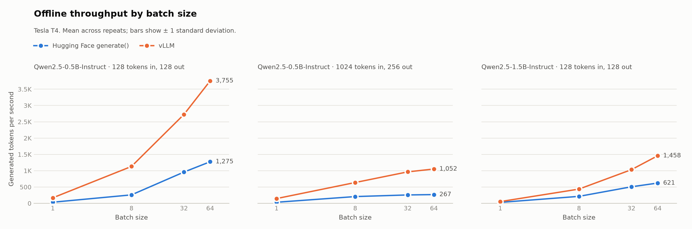

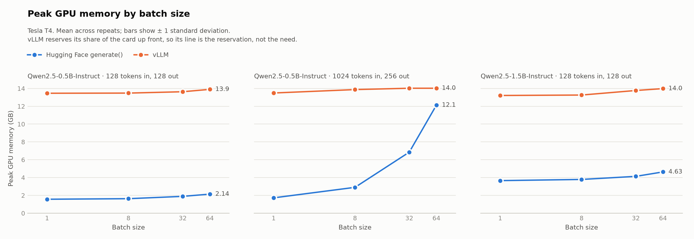

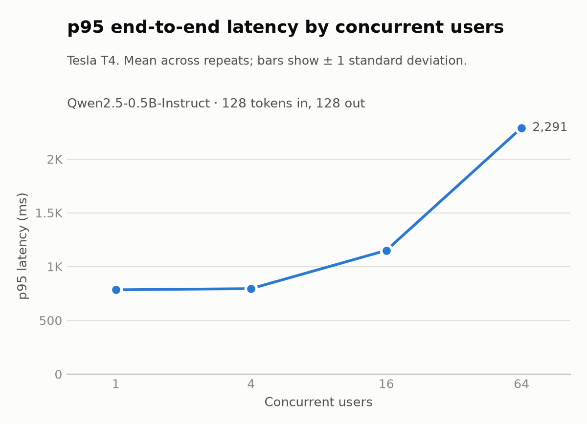

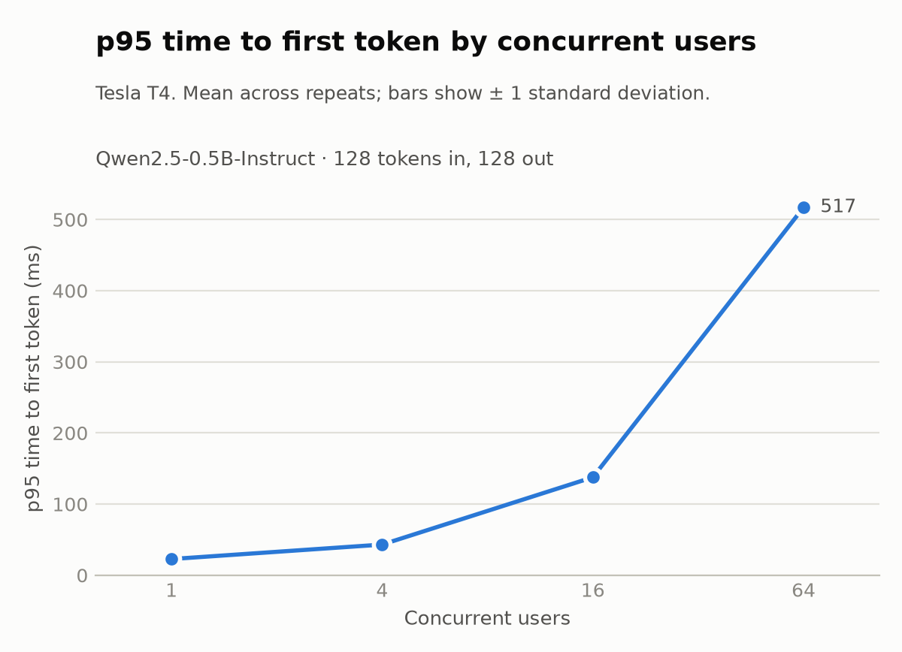

## Optimization experiments

The baseline points at three bottlenecks: requests queue before their first
token, Hugging Face leaves the GPU idle at small batches, and memory caps
concurrency. Each experiment below changes one setting against a control run
measured in the same session, and is judged on the metric its hypothesis names.

**E4, E3 and E1 have been measured on the T4 so far.** The result table of E2
is a placeholder until its run lands.

### Checkpoints

Harness (shared by every experiment):

- [x] Open-loop load: Poisson arrivals at fixed request rates, next to the
      closed-loop mode (`open_loop` in a config; results in `summary_open.csv`)
- [x] Server pinned to cores 0–2 and the load client to core 3, with each
      side's CPU utilization recorded per repeat (`cpu`)
- [x] vLLM's `/metrics` scraped during each repeat: running and queued
      requests, KV cache use (`scrape_metrics`; samples in `server_metrics.csv`)
- [x] Output fingerprint per request (online) or batch (offline), to check
      that an optimization leaves greedy outputs unchanged
- [x] Longest gap between two streamed tokens per request, for stalls that
      the mean inter-token latency hides
- [x] `python -m analysis.compare <experiment>`: each run against its control,
      with the noise-floor rule applied
- [x] `scripts/kaggle_job.py`: start a run on a Kaggle T4 and fetch its results
- [x] `--smoke` of E4 on the T4 (all five configs)
- [x] `--smoke` of E3 on the T4: `taskset` pinning, the `/metrics` gauge
      names, open-loop load and exact 1,024-token prompts all confirmed
      against vLLM 0.31.0
- [x] `--smoke` of E1 on the T4: vLLM 0.31.0 accepts `max_num_seqs` and
      `max_num_batched_tokens` as written
- [ ] `--smoke` of E2 on the T4 (confirms `enable_chunked_prefill: false`)
- [x] The `vllm_online` baseline (1,802 and 3,629 tokens/s at 16 and 64
      users) is reproduced with pinning and scraping on: the seven E1 runs
      after the control gave 1,799 to 1,823 and 3,580 to 3,653 where their
      limit does not bind. The control itself, which ran first, came out 5%
      higher (1,896 and 3,814); see [E1](#e1-scheduler-limits)

Experiments, in the order they will run:

| # | Experiment | Setup | Smoke on T4 | Measured | Written up |
| --- | --- | :---: | :---: | :---: | :---: |
| E4 | CUDA graphs against eager | ✅ | ✅ | ✅ | ✅ |
| E3 | Prefix caching | ✅ | ✅ | ✅ | ✅ |
| E1 | Scheduler limits | ✅ | ✅ | ✅ | ✅ |
| E2 | Chunked prefill | ✅ | ☐ | ☐ | ☐ |
| E5 | 4-bit weight quantization | ☐ | ☐ | ☐ | ☐ |
| E6 | Speculative decoding | ☐ | ☐ | ☐ | ☐ |

After the runs: charts per experiment, and a table of which setting to use for
low-latency, high-throughput and memory-limited serving.

### How a result is judged

- **Noise floor.** A change counts only if it is larger than twice the larger
  standard deviation of the two runs compared (3 repeats each).
  `analysis.compare` prints such changes in bold.
- **Same outputs.** Decoding is greedy, so E1 to E4 should return the same
  text as their control. `analysis.compare` reports the share of outputs whose
  fingerprint matches; a mismatch is reported, not hidden.
- **No hidden regressions.** Every row carries throughput, time to first
  token, inter-token latency, p95 end-to-end latency and peak memory, so a
  gain on one that costs another is visible.

### E4: CUDA graphs against eager

**Symptom.** At batch 1, vLLM ran 5.1× faster than Hugging Face (168 against
33 tokens/s) and kept the GPU 99% busy against 38%.

**Hypothesis.** Most of that lead comes from removing per-token launch
overhead. Turning CUDA graphs off should narrow vLLM's lead; a static KV cache
and `torch.compile` should close part of the gap from the Hugging Face side.

| Config | Change from its control |
| --- | --- |
| `e4_hf_control` | Hugging Face as in the baseline: batch sizes 1 and 8, 32 prompts |
| `e4_hf_static` | `hf.cache_implementation: static` |
| `e4_hf_compiled` | Static cache plus `hf.compile: true`; compilation falls in the untimed warm-up |
| `e4_vllm_control` | vLLM with its defaults |
| `e4_vllm_eager` | `vllm.enforce_eager: true` |

**Primary metrics.** Tokens/s and GPU utilization at batch 1.

**Results.** Printed by `python -m analysis.compare e4`: mean ± standard
deviation over 3 repeats, with the change from the run's control in brackets.
Every change shown is beyond the noise floor.

| Batch | Run | Throughput (tok/s) | GPU utilization (%) | p95 latency (ms) |
| ---: | --- | ---: | ---: | ---: |
| 1 | `e4_hf_control` | 34 ± 0 | 38 ± 0 | 3,833 ± 19 |
| 1 | `e4_hf_static` | 37 ± 0 (+9%) | 38 ± 0 | 3,544 ± 9 (−8%) |
| 1 | `e4_hf_compiled` | 120 ± 1 (+254%) | 81 ± 0 (+111%) | 1,083 ± 18 (−72%) |
| 1 | `e4_vllm_control` | 163 ± 4 | 99 ± 0 | 813 ± 35 |
| 1 | `e4_vllm_eager` | 40 ± 0 (−76%) | 32 ± 0 (−67%) | 3,305 ± 5 (+307%) |
| 8 | `e4_hf_control` | 263 ± 0 | 42 ± 0 | 3,944 ± 26 |
| 8 | `e4_hf_static` | 290 ± 2 (+11%) | 39 ± 0 (−7%) | 3,551 ± 38 (−10%) |
| 8 | `e4_hf_compiled` | 788 ± 3 (+200%) | 86 ± 1 (+103%) | 1,307 ± 7 (−67%) |
| 8 | `e4_vllm_control` | 1,133 ± 3 | 99 ± 0 | 906 ± 1 |
| 8 | `e4_vllm_eager` | 313 ± 2 (−72%) | 31 ± 0 (−68%) | 3,312 ± 38 (+266%) |

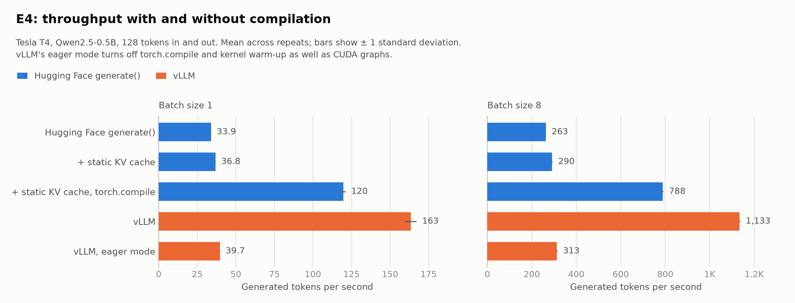

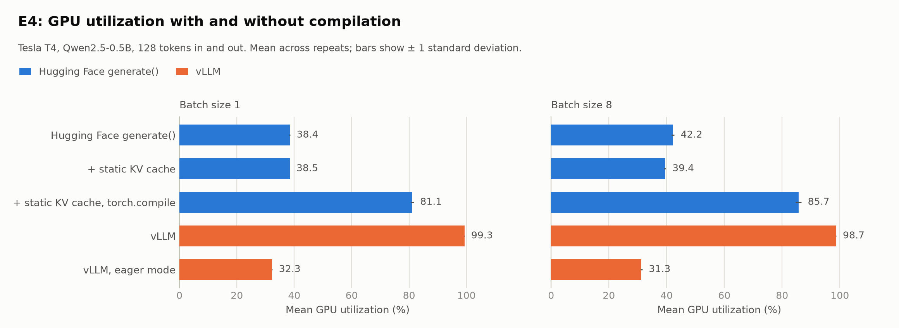

- **The hypothesis held.** Without graph capture and compilation, vLLM ran at
  40 tokens/s at batch 1, 1.2× Hugging Face's 34, against 4.8× with them on.
  Its GPU utilization fell from 99% to 32%, below Hugging Face's 38%.
- **Compiling closed most of the gap from the Hugging Face side.**
  `generate()` with a static cache and `torch.compile` reached 120 tokens/s at
  batch 1, 3.5× its control and 73% of vLLM, with the GPU 81% busy. At batch 8
  it reached 788 tokens/s, 70% of vLLM.
- **The static cache alone gave 9% to 11%.** It left GPU utilization where it
  was; the gain came with compilation.
- **What `enforce_eager` turns off.** In vLLM 0.31.0 the flag disables
  `torch.compile` and kernel warm-up as well as CUDA graphs, so this run
  measures the three together and cannot credit CUDA graphs alone.
- **Outputs were not all identical.** Each run produced the same tokens on
  every repeat, but against its control a few batches differed: 2 of the 36
  distinct batches for each Hugging Face run and 3 of 36 for eager vLLM (102
  and 99 of 108 batch fingerprints matched). The likely cause is fp16
  near-ties in greedy decoding resolving differently on a different compute
  path; that has not been confirmed by inspecting the tokens, since only
  fingerprints were recorded.

The controls match the baseline (34 against 33 tokens/s for Hugging Face at
batch 1, 163 against 168 for vLLM) on 32 prompts instead of 64. The run took
31 minutes on the T4 at commit `5a658eb`; compilation fell in the untimed
warm-up and is not in these figures.

### E3: Prefix caching

**Symptom.** From 1 to 64 users, median time to first token grew 16× (21 to
335 ms) while inter-token latency grew 2.5×: the wait is in prefill.

**Hypothesis.** When prompts share a system prompt, caching it removes half of
each prefill and time to first token drops.

**Workload.** 1,024-token prompts whose first 512 tokens are identical
(`data/prompts_shared_prefix.json`). Every request gets a suffix that has never
been sent before, built at run time from words that are one token each. The
baseline prompt sets repeat across warm-ups and repeats, so with a cache on
they would hit on the whole prompt and overstate the gain; here the shared
prefix is the only thing a cache can reuse.

| Config | Change from its control |
| --- | --- |
| `e3_control` | The shared-prefix workload, prefix caching off |
| `e3_prefix_cache` | `vllm.enable_prefix_caching: true` |

**Primary metric.** Time to first token, p50.

**Results.** Printed by `python -m analysis.compare e3`: mean ± standard
deviation over 3 repeats, with the change from the control in brackets. Bold
marks a change beyond the noise floor.

Open loop, requests arriving at a fixed rate:

| Requests/s | Run | TTFT p50 (ms) | TTFT p95 (ms) | ITL mean (ms) | E2E p95 (ms) | Throughput (tok/s) |
| ---: | --- | ---: | ---: | ---: | ---: | ---: |
| 2 | `e3_control` | 139 ± 0 | 279 ± 65 | 9.6 ± 0.8 | 2,020 ± 416 | 251 ± 26 |
| 2 | `e3_prefix_cache` | 103 ± 1 (**−26%**) | 171 ± 36 (−39%) | 8.4 ± 0.5 (−12%) | 1,620 ± 283 (−20%) | 252 ± 27 (+0%) |
| 6 | `e3_control` | 365 ± 24 | 753 ± 61 | 49.8 ± 8.0 | 9,439 ± 2,326 | 681 ± 6 |
| 6 | `e3_prefix_cache` | 160 ± 13 (**−56%**) | 318 ± 44 (**−58%**) | 24.3 ± 2.7 (**−51%**) | 4,431 ± 500 (**−53%**) | 729 ± 16 (**+7%**) |

Closed loop, a fixed number of users:

| Users | Run | TTFT p50 (ms) | TTFT p95 (ms) | ITL mean (ms) | E2E p95 (ms) | Throughput (tok/s) |
| ---: | --- | ---: | ---: | ---: | ---: | ---: |
| 16 | `e3_control` | 653 ± 20 | 1,206 ± 39 | 20.7 ± 0.4 | 3,679 ± 107 | 626 ± 15 |
| 16 | `e3_prefix_cache` | 668 ± 5 (+2%) | 997 ± 47 (**−17%**) | 16.5 ± 0.3 (**−20%**) | 2,928 ± 29 (**−20%**) | 754 ± 6 (**+20%**) |
| 64 | `e3_control` | 964 ± 6 | 6,751 ± 15 | 66.3 ± 0.2 | 16,610 ± 53 | 751 ± 2 |
| 64 | `e3_prefix_cache` | 1,186 ± 4 (**+23%**) | 4,524 ± 13 (**−33%**) | 51.6 ± 0.2 (**−22%**) | 11,796 ± 59 (**−29%**) | 975 ± 1 (**+30%**) |

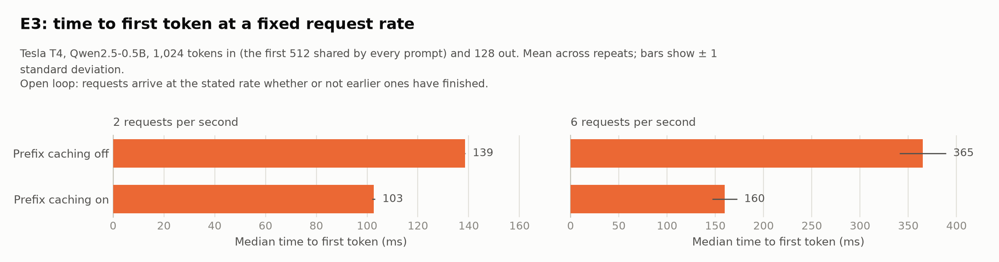

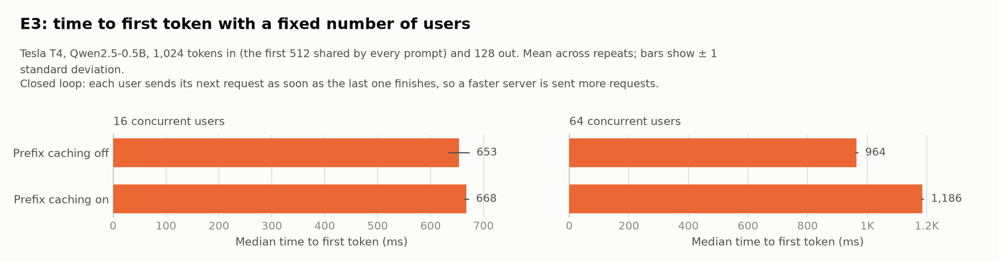

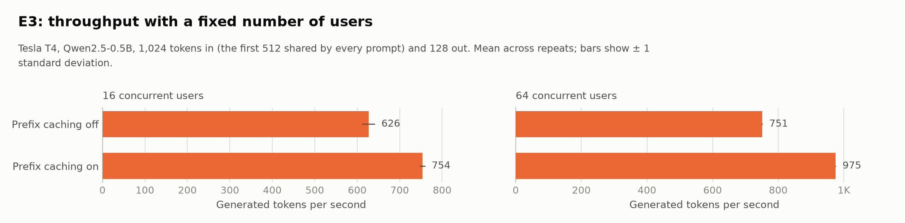

- **At a fixed request rate the hypothesis held.** Median time to first token
  fell 26% at 2 requests/s (139 to 103 ms) and 56% at 6 requests/s (365 to
  160 ms).
- **With a fixed number of users it did not, on the primary metric.** Median
  time to first token was unchanged at 16 users and 23% higher at 64. The
  gain went into throughput instead: 20% more tokens/s at 16 users and 30% at
  64, with p95 time to first token down 17% and 33% and p95 end-to-end
  latency down 20% and 29%. Closed-loop users send their next request as soon
  as the last one returns, so the faster server was sent more requests (7.6
  against 5.9 per second at 64 users) and the queue in front of it stayed
  full. This is the wave effect the open-loop mode was added to remove.
- **Part of the 6 requests/s gain is the control saturating.** The control's
  closed-loop ceiling was 5.9 requests/s, and at an offered 6 it completed
  5.3; with the cache on the ceiling was 7.6. At 2 requests/s neither server
  was near its limit, so the 26% there is the cleaner estimate of what the
  cache saves per request.
- **Peak KV cache use fell by 42% to 71%** (from 7.3% to 4.1% at 64 users),
  since the shared prefix is stored once.
- **Outputs were not all identical:** 715 of 768 closed-loop outputs and 524
  of 576 open-loop outputs matched the control (93% and 91%). As in E4, only
  fingerprints were recorded, so the cause is unconfirmed.
- **The noise flag at 2 requests/s is an artifact.** Both runs were flagged
  for a throughput spread just over 10% there. Below saturation, open-loop
  throughput is set by the arrival schedule, which differs between repeats
  and is identical between the two runs (251 ± 26 against 252 ± 27), so the
  spread is not measurement noise and the setting was not rerun.

No request failed, every prompt was 1,024 tokens on the server, and the
client core stayed under 15% busy. The run took 21 minutes on the T4 at commit
`a7f33f7`.

### E1: Scheduler limits

**Symptom.** At 64 users the server reached 3,629 tokens/s at a p95
end-to-end latency of 2,291 ms, with a p95 time to first token of 517 ms.

**Hypothesis.** Capping how many sequences run at once trades peak throughput
for lower tail latency. The per-step token budget decides how fast a wave of
new prompts is prefilled: 64 prompts of 128 tokens are 8,192 tokens.

| Config | Change from its control |
| --- | --- |
| `e1_control` | vLLM's default scheduler limits |
| `e1_seqs_016`, `_032`, `_064`, `_128` | `vllm.max_num_seqs` |
| `e1_tokens_1024`, `_4096`, `_8192` | `vllm.max_num_batched_tokens` |

**Primary metrics.** p95 end-to-end latency and throughput at 64 users, with
queued requests from `/metrics` to show where the time went.

**Results.** Printed by `python -m analysis.compare e1`, which also has the
16-user and open-loop rows: mean ± standard deviation over 3 repeats, with the
change from the control in brackets. Closed loop at 64 users:

| Run | Throughput (tok/s) | E2E p95 (ms) | TTFT p50 (ms) | ITL mean (ms) | Longest token gap p95 (ms) | Queued requests (mean) |
| --- | ---: | ---: | ---: | ---: | ---: | ---: |
| `e1_control` | 3,814 ± 19 | 2,169 ± 15 | 331 ± 19 | 14.1 ± 0.1 | 100 ± 1 | 0.5 |
| `e1_seqs_016` | 1,842 ± 16 (−52%) | 4,521 ± 47 (+108%) | 3,376 ± 27 (+920%) | 7.9 ± 0.1 (−44%) | 54 ± 3 (−46%) | 33.8 |
| `e1_seqs_032` | 2,735 ± 28 (−28%) | 3,100 ± 29 (+43%) | 1,572 ± 15 (+375%) | 10.5 ± 0.1 (−26%) | 104 ± 1 (+4%) | 22.6 |
| `e1_seqs_064` | 3,580 ± 50 (−6%) | 2,310 ± 38 (+7%) | 367 ± 21 (+11%) | 15.0 ± 0.2 (+6%) | 111 ± 2 (+10%) | 0.9 |
| `e1_seqs_128` | 3,605 ± 34 (−5%) | 2,304 ± 20 (+6%) | 365 ± 9 (+10%) | 14.9 ± 0.1 (+6%) | 111 ± 1 (+10%) | 1.4 |
| `e1_tokens_1024` | 3,653 ± 54 (−4%) | 2,339 ± 18 (+8%) | 305 ± 28 (−8%) | 14.9 ± 0.1 (+6%) | 57 ± 2 (−43%) | 2.8 |
| `e1_tokens_4096` | 3,611 ± 33 (−5%) | 2,287 ± 17 (+5%) | 411 ± 42 (+24%) | 14.7 ± 0.1 (+4%) | 201 ± 3 (+100%) | 0.2 |
| `e1_tokens_8192` | 3,616 ± 25 (−5%) | 2,290 ± 13 (+6%) | 406 ± 72 (+23%) | 14.6 ± 0.1 (+4%) | 240 ± 16 (+139%) | 0.0 |

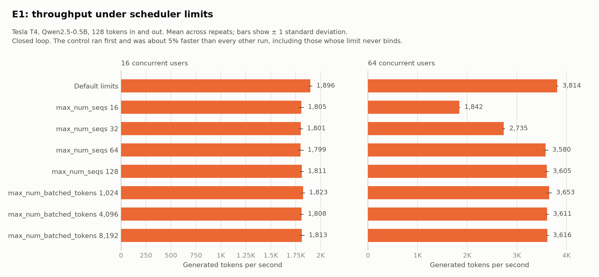

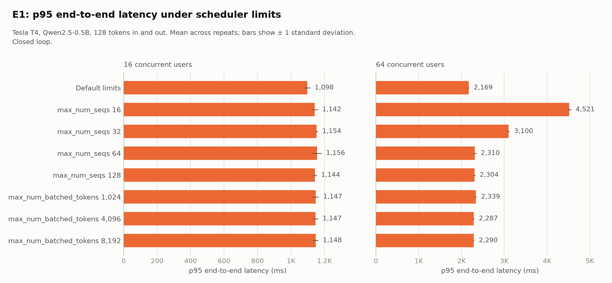

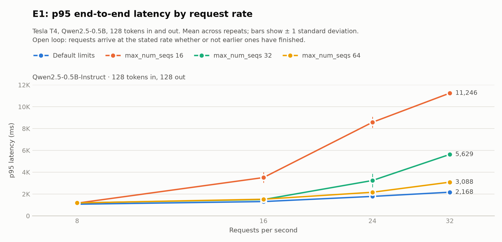

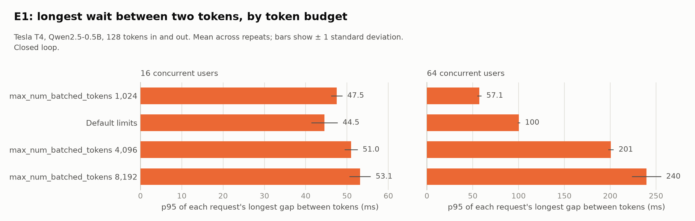

- **The hypothesis did not hold: no limit lowered tail latency.** A cap below
  the number of users cost both metrics at once. At 64 users,
  `max_num_seqs: 16` halved throughput (3,814 to 1,842 tokens/s) and doubled
  p95 end-to-end latency (2,169 to 4,521 ms); a cap of 32 cost 28% and added
  43%. The default limits were the best setting measured on both.
- **A cap moves the wait from between tokens to before the first one.** With
  16 sequences running, tokens came every 7.9 ms instead of 14.1, but 34
  requests on average sat in the queue and median time to first token went
  from 331 to 3,376 ms. A cap helps only if steady token pacing matters more
  than the wait to start.
- **Open loop shows the same thing at a fixed request rate.** At 16
  requests/s a cap of 16 already queues (p95 end-to-end 3,510 ms against
  1,309); at 32 requests/s p95 was 11,246 ms with a cap of 16, 5,629 with 32,
  3,088 with 64 and 2,168 with the defaults. A cap of 128 was
  indistinguishable from the defaults on throughput and end-to-end latency.
- **The token budget sets how long decoding stalls, and little else.**
  Throughput and p95 end-to-end latency stayed within 8% of the control for
  all three budgets. The longest gap between two tokens followed the
  budget: 57 ms at 1,024 tokens, 100 at the default, 201 at 4,096 and 240 at
  8,192. The default sitting between 1,024 and 4,096 suggests it is 2,048,
  but the server log does not print it.
- **The control ran about 5% faster than everything else, so small closed-loop
  differences are not attributable to a setting.** Every other run, including
  those whose limit cannot bind (a cap of 128 with 16 users), gave 4% to 6%
  less throughput than the control, and those runs match the published
  baseline while the control exceeds it. The control was the first server
  launched in the session. The cause is not established; a cooler GPU at the
  start is one candidate. The noise floor is computed from repeats within one
  server launch and does not cover this, so changes of this size are marked
  as beyond noise by `analysis.compare` without being real effects of the
  setting.
- **Caps of 64 or lower raised light-load latency too.** At 8 requests/s,
  where about 8 requests are in flight and no cap binds, median time to first
  token was 42 to 43 ms with caps of 16, 32 and 64 against 33 ms for the
  control and 32 ms for a cap of 128. The cause is not established.
- **Outputs were not all identical:** 93% to 97% of outputs matched the
  control's in every run, as in E4 and E3.

No request failed and no setting was flagged as noisy. The run took 56 minutes
on the T4 at commit `14ceba7`.

### E2: Chunked prefill

**Symptom.** The same queueing before the first token. The online baseline
used 128-token prompts only, so long prompts under load are unmeasured so far.

**Hypothesis.** A 1,024-token prefill done in one step holds up every running
decode. Splitting it into chunks lets decodes keep running, which lowers p95
time to first token and steadies inter-token latency.

| Config | Change from its control |
| --- | --- |
| `e2_control` | 1,024 tokens in, 256 out, `vllm.enable_chunked_prefill: true` |
| `e2_chunked_off` | `vllm.enable_chunked_prefill: false` |
| `e2_control_repeat` | Nothing: the control again, run last, to show how much the order of the runs moves the numbers (see [E1](#e1-scheduler-limits)) |

**Primary metrics.** Time to first token p95, and the longest gap between two
tokens p95.

**Results.** _Pending: `python -m analysis.compare e2`._

### E5 and E6

Not set up yet. E5 serves a 4-bit AWQ or GPTQ build of Qwen2.5-1.5B to free
memory for the KV cache, with a quality check against fp16. E6 uses the 0.5B
model to draft tokens for the 1.5B (speculative decoding); the two share a
tokenizer.

### Running them

Every optimization config extends `configs/_opt.yaml`, the online baseline
with the measurement changes on, or an offline baseline config for E4. Run one
like any other experiment:

```bash
python -m bench.run configs/e1_seqs_016.yaml --smoke   # check it starts
python -m bench.run configs/e1_seqs_016.yaml
python -m analysis.compare e1
```

Or run a whole experiment on a Kaggle T4 from a terminal, with the
[Kaggle CLI](https://github.com/Kaggle/kaggle-cli) installed and logged in:

```bash
python scripts/kaggle_job.py push e4 --smoke   # a few minutes: every e4 config, tiny
python scripts/kaggle_job.py push e4           # the real run
python scripts/kaggle_job.py status e4
python scripts/kaggle_job.py fetch e4          # copies the run into results/
```

`push` starts a private kernel that clones this repo at the current commit, so
the commit has to be on GitHub first.

## Methodology

### Setup

| Piece | Choice |
| --- | --- |
| GPU | One NVIDIA Tesla T4 (15 GB) on Kaggle, driver 580.178.04, CUDA runtime 13.0 |
| Software | Python 3.13.15, torch 2.13.0, transformers 5.17.0, vLLM 0.31.0 |
| Models | Qwen2.5-0.5B-Instruct (main), Qwen2.5-1.5B-Instruct (second size) |
| Precision | fp16 (the T4 has no bf16) |
| Serving stacks | Hugging Face `transformers` `generate()`; vLLM `LLM.generate()` and its OpenAI-compatible server |
| Prompts | 64 fixed synthetic prompts per length, committed under `data/` |

Each run's GPU, driver and package versions are in `results/<run>/env.json`,
next to the resolved config it ran with. `requirements.lock.txt` lists all 207
packages of the measured environment.

### Experiments

Each experiment is one YAML file under `configs/`. A config extends another and
states only what it changes, so two experiments differ by exactly what their
files say.

| Config | What it measures |
| --- | --- |
| `hf_offline_short` | Hugging Face, 128 tokens in and 128 out, batch sizes 1, 8, 32, 64 |
| `hf_offline_long` | The same with 1,024 tokens in and 256 out |
| `vllm_offline_short`, `vllm_offline_long` | The same two settings through vLLM |
| `hf_offline_short_1p5b`, `vllm_offline_short_1p5b` | The short setting on the 1.5B model |
| `vllm_online` | vLLM's server under 1, 4, 16 and 64 concurrent users, 128 requests per level |

### Metrics

| Metric | Definition |
| --- | --- |
| Throughput (tokens/s) | Generated tokens ÷ wall-clock time of the whole repeat |
| Time to first token (ms) | Request sent → first streamed chunk received (online) |
| Inter-token latency (ms) | (Last chunk − first chunk) ÷ (generated tokens − 1), averaged over requests (online) |
| End-to-end latency p50 / p95 / p99 (ms) | Online: request sent → last token received. Offline: the time of the batch the request was in |
| Peak GPU memory (GB) | Largest NVML reading for the whole device during the repeat |
| GPU utilization (%) | Mean of NVML readings taken every 0.5 s during the repeat |

### Rules for every run

- **Warm-up:** 3 untimed batches before each setting. Online, a batch is one
  wave of requests at that concurrency.
- **Repeats:** 3 per setting, reported as mean ± standard deviation. A setting
  whose throughput spread (std ÷ mean) exceeds 10% is flagged, and
  `--redo-noisy` reruns it. No setting needed a rerun.
- **Fixed inputs:** every prompt in a set is exactly 128 or exactly 1,024
  tokens, so batches need no padding and each request is the same work.
- **One change at a time:** each config differs from its parent in one respect.

### What keeps the comparison fair

- **Same output length.** Both backends ignore the end-of-sequence token and
  generate exactly the configured number of tokens for every prompt. The raw
  CSVs confirm identical prompt and output token counts on both.
- **Same decoding.** Greedy, with no repetition penalty. The model repository's
  default generation settings enable sampling and a repetition penalty; both
  backends override them.
- **No prefix caching in the baseline.** vLLM enables it by default, and
  warm-ups and repeats resend the same prompts, so a cache hit would skip work
  that Hugging Face has to do. It is off unless an experiment turns it on.
- **Same timed region.** Both backends are handed raw strings, so tokenization
  is inside the measurement for both.
- **One GPU.** Kaggle provides two T4s; every run is pinned to the first.

### Reading the memory numbers

vLLM reserves a fixed share of GPU memory up front (`gpu_memory_utilization`,
0.90 here) for its KV cache, so its 13 to 14 GB is the size of that reservation,
not what the workload needed. The Hugging Face column is what PyTorch held at
the peak. The CSVs also record PyTorch's own peak allocation for Hugging Face
(`peak_torch_alloc_gb`), which is lower still.

## Reproduce

```bash
pip install -r requirements.txt
python -m bench.run configs/hf_offline_short.yaml    # writes results/hf_offline_short/
python -m analysis.plots                             # writes analysis/figures/
```

On Kaggle, create a notebook with the **GPU T4 x2** accelerator and internet
access turned on, clone this repo, and run the same commands from its root with
a leading `!`. The numbers above came from a clean virtual environment built
from `requirements.txt` in a fresh Kaggle session; the seven experiments took
115 minutes in total.

Useful flags for `bench.run`:

| Flag | Effect |
| --- | --- |
| `--smoke` | A tiny version of the experiment, written to `results/_smoke/`. Use it first to check that a backend installs and runs |
| `--redo-noisy` | Rerun only the settings whose spread exceeded 10% |
| `--overwrite` | Discard the run's existing results and start again |

Running a config again without flags resumes it: settings already on disk are
skipped, so a session that times out loses at most the repeat in progress.

`python -m bench.prompts` is how the prompt sets under `data/` were built. It
does not need to be run again.

## Limitations and next steps

- One GPU type (T4, fp16 only) and two small models (0.5B and 1.5B). The
  results do not predict behaviour on larger models or data-centre GPUs.
- Everything was measured in a single Kaggle session on one physical card. The
  small spread describes repeats within that session, not variation between
  sessions or machines.
- Synthetic prompts of uniform length. Real traffic has mixed lengths, which
  changes how well batching works.
- The online load is closed-loop and every request is the same length, so the
  simulated users stay in step and their requests arrive in waves. Time to
  first token at 64 users is therefore close to a worst case of 64 simultaneous
  arrivals, not what a steady arrival rate would show.
- The load client runs on the same 4-core machine as the server.
- A single node with one GPU: no tensor parallelism or multi-GPU serving.
- Offline latency percentiles are over batches, and at batch size 64 a repeat
  is a single batch.

Next: the [optimization experiments](#optimization-experiments). Their harness
adds open-loop load and client pinning, which address the two limitations
above about wave arrivals and the shared machine; the baseline numbers
themselves are unchanged.
